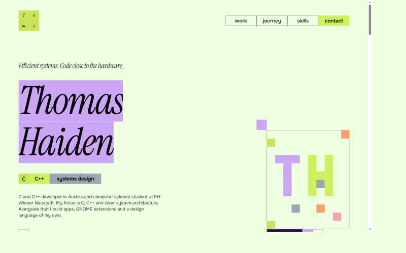
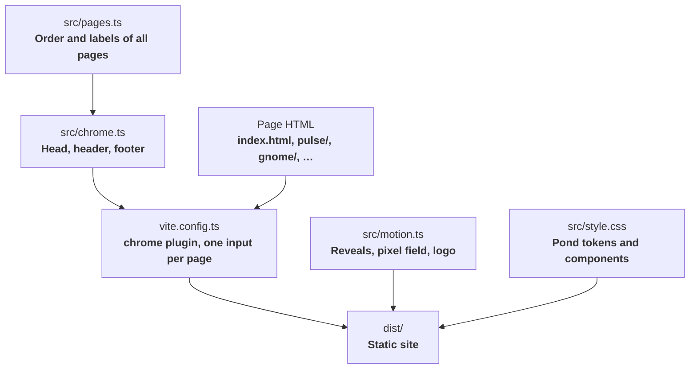

<div align="center">
  
  <h1>thomas-haiden.com</h1>
  <p><strong>The personal site of Thomas Haiden: eight static pages in the Pond style, flat tiles on a 40px grid, italic serifs and motion in steps.</strong></p>

  <p>
    
    
    
    
  </p>
</div>

---



---

## Architecture

Every page is a plain HTML file. A small **Vite** plugin fills in the shared head, header and footer at build time, so the navigation works without JavaScript. One **TypeScript** module adds the motion on top.



## Pages

| **Path** | **Content** |
| :--- | :--- |
| **/** | Hero with a pixel field, projects, more repos, journey, skills, contact |
| **/pulse/** | Pulse, the health app for Android |
| **/tomsllama/** | tomsllama, the desktop client for local Ollama models |
| **/gnome/** | Halo, Harbor, Ledge, Tally, Ember and Torch |
| **/design/** | Toms Expressive Design |
| **/knot/** | Team Knot and OutAbout |
| **/journey/** | Five stations, from school to the BSc |
| **/systems/** | C, C++, memory layout, SQL and hardware |

A new page needs an HTML file with `<body data-page="…">` and an entry in **src/pages.ts**; the build picks it up from there.

## Motion

- **On load:** Elements above the fold wipe in over four steps; headline lines stamp in quarter by quarter.
- **On scroll:** Sections wipe or drop in as they reach the lower edge of the window. Things that arrive together follow one another, 95 ms apart.
- **Pixel field:** The home hero draws a **T** and an **H** in 40px cells, then lights one empty cell at a time while it is on screen.
- **Reduced motion:** With `prefers-reduced-motion: reduce` every element is shown in its final state and nothing moves.
- **Without JavaScript:** Hidden start states apply only under `html.motion`, which an inline script sets; if the motion module never runs, the class is removed again after 2.5 s.

## Assets

| **Path** | **Source** |
| :--- | :--- |
| **public/fonts/** | Instrument Serif, Onest, IBM Plex Mono, JetBrains Mono (latin subsets, SIL Open Font License) |
| **public/shots/** | Screenshots from the `readmestuff/` folder of each repository |
| **public/knot.svg** | The Knot logo, Logo 02 from the Knot design files |

## Development

```bash
npm install
npm run dev
```

`npm run check` builds the site and fails if any page links to a local file that is not in `dist/`.

## Status

- **Build and link check:** *tested*, `npm run check` passes.
- **Desktop (1440px) and phone (375px):** *tested* in the browser, all eight pages, no horizontal scroll.
- **Reduced motion:** *built*, not yet checked in a browser with the setting on.
- **Vercel:** *planned*.
