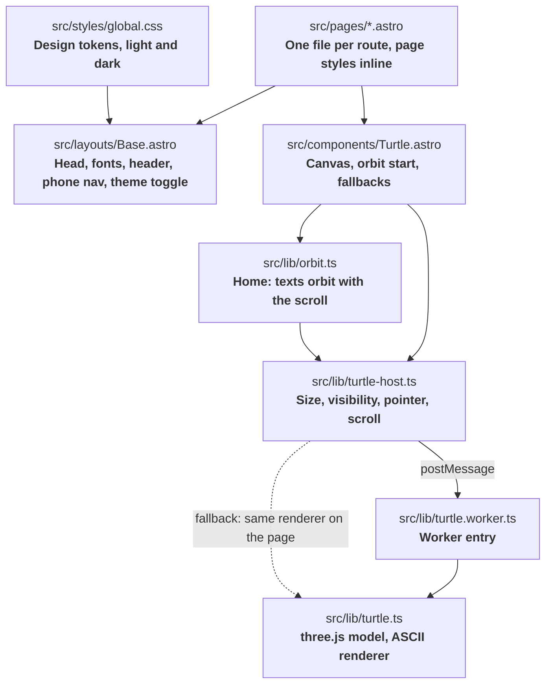

<div align="center">
  
  <h1>thomas-haiden.com</h1>
  <p><strong>The personal site of Thomas Haiden: eight static pages, an editorial grid in Geist Serif and Montserrat, and a sea turtle drawn in text characters.</strong></p>

  <p>
    
    
    
    
  </p>
</div>

---

## Architecture

Every route is one **Astro** page that renders to plain HTML with its CSS inlined. **Base.astro** holds the head, the header, the phone nav and the theme toggle; **Turtle.astro** holds the canvas and its client script. After the `load` event, once the main thread is idle, the canvas is handed to a **Web Worker** (`OffscreenCanvas`), which loads **three.js** and draws the turtle there. Browsers without WebGL in workers get the same renderer on the main thread.



## Pages

| **Route** | **Content** |
| :--- | :--- |
| **/** | Name, about, projects, path, skills and contact orbiting the turtle; the last chapter turns dark |
| **/projects** | The four projects as a list |
| **/projects/gnome** | Tally, Ember and Torch for GNOME Shell 50 |
| **/projects/wanna** | wanna?, the team app with Knot |
| **/projects/design** | Toms Expressive Design |
| **/projects/pulse** | Pulse, the health app |
| **/path** | Five stations, from middle school to the BSc |
| **/skills** | C and C++, memory layout, SQL and hardware |

Open placeholders are listed in **TODO.md**.

## The Turtle

- **Model:** A low-poly sea turtle built from a few jittered spheres in **three.js**, rendered into a render target at one pixel per character and read back.
- **Output:** Each pixel becomes a character from `@#%&8B$*o+=~-:,.` by brightness, drawn in the accent colour on a 2D canvas. Bubbles rise as `o`, `°` and `.`.
- **Motion:** Head and body follow the pointer; the turtle builds itself up character by character on load. On **/** it turns with the scroll; on the other pages it swims in from the left and sits sticky on the right (on top on phones).
- **Cost:** About **30 fps**, device pixel ratio capped at **2**, paused while the tab is hidden or the canvas is off screen. The ASCII output is one `fillText` per row; IBM Plex Mono advances exactly 0.6em, the width of a cell.
- **Off the main thread:** Creating the WebGL context, building the model and the first render take several hundred milliseconds on a throttled phone. In the worker none of that blocks scrolling or input.

## Fallbacks

| **Situation** | **What the visitor gets** |
| :--- | :--- |
| **prefers-reduced-motion** | No animation; the home texts are stacked and visible at once, the turtle is a single still frame |
| **No WebGL** | The worker and then the page try to create a context; when both fail, the home texts are stacked and the canvases stay empty |
| **No JavaScript** | Same stacked layout; all links are real links |

## Light and Dark

- **Default:** The system setting (`prefers-color-scheme`); a small inline script sets `data-theme` on `<html>` before the first paint.
- **Toggle:** **Dark** in the nav (and in the phone bar), underlined while dark mode is on. The choice is kept in `localStorage`.
- **Tokens:** Dark mode uses the values the home page already uses for its last chapter (`#0d0f12`, `#f4f7f8`, accent `#3aa6ec`). The last home chapter is dark in both modes.

## Fonts

| **Family** | **Use** | **Source** |
| :--- | :--- | :--- |
| **Geist Serif** | Headlines | npm `geist`, **GeistSerifVF.woff2**, preloaded |
| **Montserrat** 300, 400, 500, 900 | Body text | npm `@fontsource/montserrat`, latin subset |
| **IBM Plex Mono** 400 | Numbers, years, details, the turtle | npm `@fontsource/ibm-plex-mono`, latin subset |

All fonts are bundled into **dist/_astro/**; nothing is loaded from Google.

## Development

```bash
npm install
```

```bash
npm run dev
```

```bash
npm run build
```

```bash
npm run preview
```

## Deployment

`npm run build` writes a static site to **dist/**. Pages are built as files (**dist/projects/gnome.html**), so the host must serve `/projects/gnome` from `projects/gnome.html`. GitHub Pages, Netlify and Cloudflare Pages do this by default; on **Vercel** the included **vercel.json** sets `cleanUrls`. **sitemap.xml** and **robots.txt** are generated for `https://thomas-haiden.com` (the `site` in **astro.config.mjs**).

## Status

Checked on 2026-11-02 against `thomas-haiden.html` with **astro preview** and headless **Chrome** (Puppeteer, software WebGL).

| **Check** | **Result** |
| :--- | :--- |
| **Build and types** | *tested*: `npm run build` and `tsc --noEmit` pass |
| **Look against the template** | *tested*: 1440px and 390px, all pages; page heights equal to the pixel, the text column differs in under 70 pixels per page (brand colour, bubbles) |
| **Turtle, orbit, dark last chapter** | *tested*: screenshots at six scroll positions next to the template |
| **Reduced motion** | *tested*: stacked texts, still turtle, no animation |
| **No WebGL** | *tested*: with GPU and software rendering disabled the texts are stacked and readable |
| **Theme toggle** | *tested*: switching, reload keeps the choice, phone bar, turtle colour |
| **Lighthouse, phone profile** | *tested*: **100 / 100 / 100 / 100** (performance, accessibility, best practices, SEO) on all eight pages, light and dark |
| **Lighthouse, desktop profile** | *tested*: **100 / 100 / 100 / 100** on all eight pages, light |
| **Safari, Firefox** | not checked |
| **Hosting** | *planned* |
